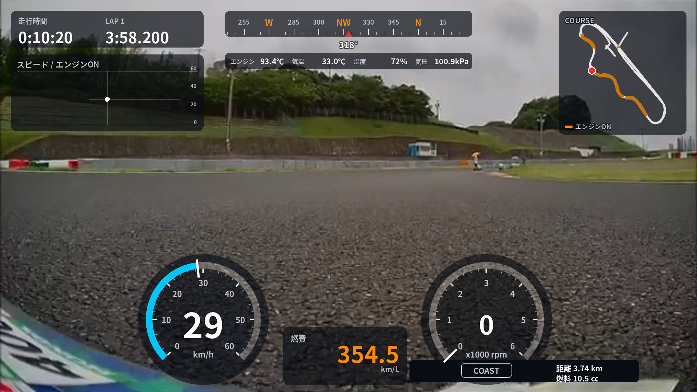

# ecorun_overlay

Honda エコマイレッジチャレンジ用の車載動画テレメトリ・オーバーレイ生成ツール。  
Chibi-T ロガーの CSV を読み込み、速度・回転数(エンジン ON / COAST)・燃費・ラップタイム・方位・コース図・標高・燃圧などを車載カメラ映像に重ねる。



## 特徴

- **パルス&グライド向け表示**: 回転数から ENGINE ON / COAST を判定し、コース図と速度グラフ上でエンジン ON 区間をオレンジで表示(コース図は走行中の周の分だけ。`on_segments_scope = "all"` で全周を重ねる)
- **燃費・積算燃料・走行距離**: 距離が短い間の不安定な燃費値は `---` で非表示
- **ラップタイム**: `ラップ数` 列の切り替わりから現在周・前周タイムを算出
- **方位**: GPS 座標の移動ベクトルから算出(低速時は直前値を保持)
- **標高・燃圧グラフ**: 標高は出力区間全体のプロファイル、燃圧は直近 60 秒をスクロール表示(エンジン ON 帯付き)
- **10 Hz / 1 Hz ログ対応**: 現行の 10 Hz フォーマットと旧 1 Hz フォーマットの列名を自動判別。センサ更新の間に同じ値が続く部分は間引いてから動画フレームレートへ線形補間
- **ドラレコ焼き込み表示のマスク**: VSYSTO F9 の日時・速度表示を `f9_mask` プリセットの帯で隠す
- **3 つの出力モード**: 静止画プレビュー / 動画へ直接合成 / 透過 ProRes 4444(編集ソフトで重ねる用)
- **レイアウトプリセット**: 配置・配色・ゲージ上限などを `presets/*.toml` に分離。`--preset` で切り替え
- **GUI エディタ**: ブラウザでウィジェットをドラッグ・リサイズし、プロパティを編集して保存(`ecorun-gui`)。プレビューは本番と同じ描画
- **AI エージェント向け**: JSON Schema・`ecorun-layout validate / lint`(`--json`)・`--debug-boxes` で、テキスト編集だけでレイアウトを変更・検証できる

## 必要なもの

- Python 3.11 以上([uv](https://docs.astral.sh/uv/) 推奨)
- ffmpeg / ffprobe(PATH が通っていること)
- 日本語フォント(Windows・macOS・Linux の標準的なものは自動検出。見つからない場合は `--font` で指定)

```bash
uv sync                          # 依存のインストール(.venv を作る)
# または
pip install -r requirements.txt
```

以下のコマンドは `uv run ecorun-overlay ...` の形で書く。`python ecorun_overlay.py ...` でも同じように動く。

## 使い方

### 1. 静止画でレイアウトを確認

```bash
uv run ecorun-overlay LOG0650.CSV --preview 150 -o preview.png
uv run ecorun-overlay LOG0650.CSV --preset minimal --preview 150 --debug-boxes -o preview.png
```

`--preview` はログ開始からの秒数。グレー背景に 1 フレーム描画する。`--debug-boxes` を付けると各ウィジェットの枠と id、配置禁止帯を重ねて描く。

### 2. 車載動画に直接合成

```bash
uv run ecorun-overlay LOG0650.CSV --preset f9_mask --video F9_0001.mp4 --sync 15:10:30 -o out.mp4
```

- 出力は H.264(`--crf` で画質指定、既定 18)。音声はコピーされる
- オーバーレイは 1920×1080 基準で描画し、動画の解像度へ自動スケール
- フレームレートと長さは動画から自動取得

### 3. 透過オーバーレイだけを書き出す

```bash
uv run ecorun-overlay LOG0650.CSV --sync 15:10:30 --duration 1300 -o overlay.mov
```

ProRes 4444(アルファ付き)を出力する。DaVinci Resolve や Premiere で映像の上に重ねて使う。

### オプション一覧

| オプション | 説明 |
| --- | --- |
| `csv` | ロガーの CSV ファイル |
| `-o`, `--output` | 出力先。`.png`(プレビュー)/ `.mp4`(合成)/ `.mov`(透過) |
| `-p`, `--preset` | レイアウトプリセット名(`presets/NAME.toml`)または `.toml` のパス。既定 `default` |
| `--video` | 合成する車載動画 |
| `--sync` | 動画の 0 秒目に対応するログ時刻(`HH:MM:SS[.f]`)、またはログ開始からの秒 |
| `--offset` | 同期の微調整 [秒]。正の値で表示が先に進む |
| `--duration` | 出力する長さ [秒]。省略時は動画長、またはログ末尾まで |
| `--preview` | ログ開始からの秒を指定して静止画 1 枚を出力 |
| `--debug-boxes` | ウィジェットの枠と id、配置禁止帯を描く |
| `--fps` | 透過出力時のフレームレート(既定 30。`--video` 指定時は動画に合わせる) |
| `--font` | 日本語フォント(`.ttf` / `.ttc`)のパス。プリセットの `theme.font` より優先 |
| `--crf` | H.264 の画質(既定 18、小さいほど高画質) |
| `--mask-osd` | (非推奨)`--preset f9_mask` と同じ |

## 動画とログの同期

1. 動画で発進の瞬間(車が動き出すフレーム)の再生位置を確認する
2. ログで速度が 0 から立ち上がる時刻を確認する
3. `--sync` = (ログの発進時刻) − (動画の発進位置) を指定する
4. `--preview` や短い `--duration` で試し、ずれを `--offset` で詰める

> VSYSTO F9 の焼き込み時刻は、カメラの時計が正しく設定されていないとログと一致しない。焼き込み時刻をそのまま `--sync` に使う前に、日付が合っているか確認すること。

## ログフォーマット

UTF-8(BOM 付き可)の CSV。列名はスクリプト冒頭の `COL` 辞書で内部キーに対応付けており、現行フォーマット(10 Hz、LOG0650 以降)と旧フォーマット(1 Hz、LOG0612 など)のどちらも読める。

| 列名(現行 / 旧) | 単位・内容 | 用途 |
| --- | --- | --- |
| 記録日時 | `YYYY/M/D HH:MM:SS.ff` | 時間軸 |
| 速度(km/h) | km/h | 速度ゲージ・グラフ |
| ラップ数(周目) / ラップ数 | 整数(スタート前は 0) | ラップ表示・ラップタイム |
| 走行時間(秒) / 走行時間 | 秒 | 走行時間表示 |
| 回転数(rpm) / 回転数 | rpm(0 = エンジン停止) | 回転ゲージ・ENGINE ON 判定 |
| 走行距離積算(m) / 走行距離 | m | 距離表示 |
| 積算燃料消費量(ml) / 積算燃料 | ml | 燃料表示 |
| 燃費(km/l) / 燃費 | km/L | 燃費表示 |
| lat(緯度) / lat、lng(経度) / lon | 度(未測位時は 0) | コース図・方位 |
| 標高(m) / alt | m | 標高グラフ |
| 温度(C) / 温度 | ℃(エンジン温度) | 環境表示 |
| 気圧(kPa) / 気温(C) / 湿度(%) | — | 環境表示 |
| 燃圧(MPa) | MPa(現行のみ) | 燃圧グラフ(列が無ければ非表示) |

次の列は読み込むが表示しない: 燃料噴射時間(ms)、点火進角角度(CA)、燃料噴射終了角度(CA)、場所 / loc、1次空気圧(MPa)、2次空気圧(MPa)。

## レイアウトプリセット

見た目の設定はすべて `presets/*.toml` にある。コードを触らずに切り替え・編集できる。

| プリセット | 内容 |
| --- | --- |
| `default` | 標準。VSYSTO F9 ローアングル前方カメラ向け |
| `f9_mask` | `default` + 右下の焼き込み表示(日時・速度)を帯で隠し、帯の中に距離・燃料を出す(旧 `--mask-osd`) |
| `minimal` | 速度・回転・燃費・コース図・走行時間だけを小さめに四隅へ置く例 |

```toml
#:schema ../schema/preset.schema.json
schema_version = 1
name = "標準"

[theme]                 # 配色(#RRGGBB / #RRGGBBAA)とフォント
accent = "#FF8C00"

[data]                  # 判定の閾値
rpm_on_threshold = 300.0

[[keepout]]             # 配置禁止帯(lint が重なりを警告)
name = "地平線"
x = 0
y = 380
w = 1920
h = 260

[[widgets]]             # 配列の順番 = 重なり順(後ろほど前面)
id = "speed_gauge"
type = "speed_gauge"
enabled = true
x = 380                 # 座標は 1920x1080 基準の px。出力時に動画解像度へスケール
y = 700
w = 360
h = 360
max = 60
step = 10
```

- ウィジェットの種類: `timer`(走行時間・ラップ)、`speed_graph`、`heading`(方位)、`env`(温度・気圧など)、`map`(コース図)、`fuel_eco`(燃費)、`odometer`(距離・燃料)、`speed_gauge`、`rpm_gauge`、`alt_graph`(標高)、`fuel_p_graph`(燃圧)、`mask`(焼き込み表示を隠す帯)、`text`(任意テキスト)
- 文字サイズや余白は型ごとの基準サイズに対する比 `min(w / 基準幅, h / 基準高さ)` で拡縮する。ゲージは box に内接する円
- 各ウィジェットのパラメータ・既定値・範囲は `uv run ecorun-layout widgets` で一覧できる
- 未知のキーや範囲外の値はエラーになる(タイポ検出のため)

### GUI エディタ

```bash
uv run ecorun-gui          # http://127.0.0.1:8765 をブラウザで開く
```

- 中央のキャンバスでウィジェットをドラッグして移動、四隅・辺のハンドルでリサイズ(ゲージは正方形を保つ。Shift で縦横比固定)。矢印キーで 1 px、Shift+矢印で 10 px
- 右のパネルで選んだウィジェットのパラメータ、「全体設定」で配色・閾値・配置禁止帯を編集
- 下のタイムラインでログの時刻を動かして確認できる。動画を指定すると、そのフレームを背景に表示し `--sync` / `--offset` の同期合わせにも使える
- 保存すると TOML のコメントや並びは保ったまま値だけ書き換える。別名で保存すると新しいプリセットになる
- 元に戻す / やり直す: ⌘/Ctrl+Z、⌘/Ctrl+Shift+Z。保存: ⌘/Ctrl+S
- TOML をテキストエディタや AI エージェントが書き換えると、GUI が自動で読み込み直す(編集中ならバナーで確認)
- 書き出し用のコマンド(プレビュー・合成・透過)が画面下に表示される
- API の一覧は <http://127.0.0.1:8765/docs>

### ecorun-layout(検証ツール)

```bash
uv run ecorun-layout list                 # プリセット一覧
uv run ecorun-layout widgets [TYPE]       # ウィジェットの種類とパラメータ
uv run ecorun-layout validate default     # スキーマ検証(未知キー・型・範囲・id 重複)
uv run ecorun-layout lint default         # キャンバス外・配置禁止帯・重なりの検査
uv run ecorun-layout schema --write       # schema/preset.schema.json を更新(config.py を変えたら)
```

いずれも `--json` で機械可読な出力になる。  
終了コードは問題なしで 0、エラーで 1(`lint --strict` は warning でも 1)。

### ログの列名

CSV の列名と内部キーの対応は `ecorun/telemetry.py` の `COL`(候補を複数書ける)と `OPTIONAL_COLS`(無くてもよい列)で定義している。

## 処理速度の目安

Apple Silicon Mac で毎秒約 50 フレーム(ProRes エンコード込み)、クラウド環境で約 13 フレーム。

## 開発

```bash
uv run pytest              # テスト(合成ログを使うので CSV は不要)
```

## ライセンス

[MIT License](LICENSE)

ffmpeg は同梱せず、外部コマンドとして呼び出している。ffmpeg 自体のライセンスは各自のインストールに従う。
